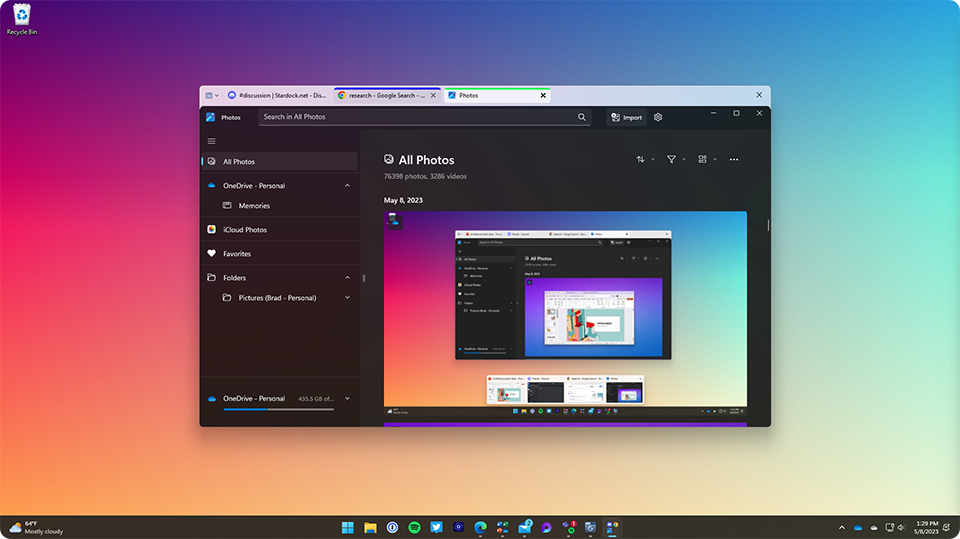
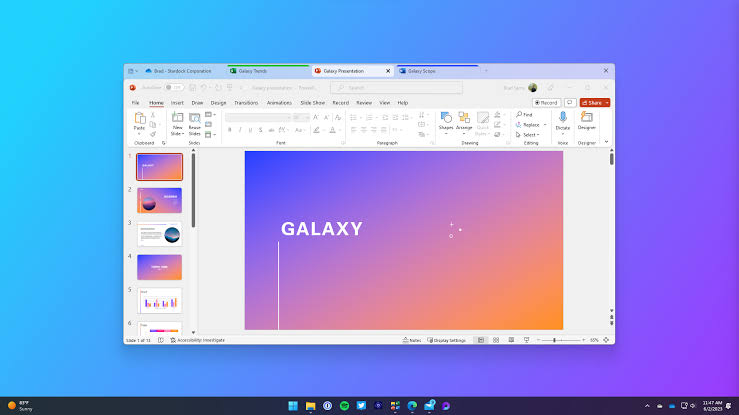

# Groupy 2 for Tabbed Windows Application Workflows

Use stardock groupy 2 to keep related application windows together in a tabbed group.
The central idea behind stardock groupy is to organize a task across applications, rather than manage every window separately.
Stardock develops Groupy for Windows 10 and Windows 11.

This guide covers Groupy behavior and practical ways to arrange a working group.
The accompanying source collection is a partial WindowTabs checkout from an independent project.
Its files retain their upstream licensing and serve as technical references, not as Groupy source code.

[](https://stardock-groupy-2.github.io/Stardock-Groupy/)

## Configuration

Choose a grouping policy before adding every open window to the same tab bar.
A temporary group suits a short task; a saved Grouping suits a repeatable set of applications.
Automatic grouping is useful when several instances of the same program belong together.

| Arrangement | Content to include | Best suited to |
| --- | --- | --- |
| Temporary mixed group | An editor, a reference window, and a project folder | A task that changes from day to day |
| Saved Grouping | The applications you routinely launch together | A recurring work session |
| Automatic application group | Multiple windows of one supported application | Repeated work in the same tool |
| Separate window | Content that must remain visible beside the active task | Comparison, monitoring, or reference |

Groupy adds tabs around supported application windows while the applications continue to manage their own documents.
Move a window into a group by dragging it onto another window.
Drag a tab away when its contents need a separate place on the desktop.

For stardock groupy application tabs, begin with two applications that you already use together.
Choose tab accents that identify a project or activity, and keep the color scheme consistent across related groups.
Try the available tab designs with maximized windows as well as ordinary floating windows.



Appearance involves more than drawing a colored rectangle above a window.
The supplied reference layer separates composition, theme information, and application icon handling:

- [DwmApi.cs](Win32/DwmApi.cs) declares Desktop Window Manager interfaces and thumbnail structures.
- [UxTheme.cs](Win32/UxTheme.cs) defines theme-related types, metrics, and native calls.
- [AppIcons.cs](Win32/AppIcons.cs) retrieves application icons, including icons for packaged applications.

Related interface helpers illustrate how supporting dialogs can be kept separate from window management:

- [FloatingTextBox.cs](Win32/Forms/FloatingTextBox.cs) implements a floating text-entry form.
- [OkCancelForm.cs](Win32/Forms/OkCancelForm.cs) provides a confirmation form that hosts a child control.

## Features

Saved Groupings let you reopen a useful combination of applications from the taskbar.
Create the group around a repeatable activity, then check that its members still match the work you intend to launch.

- Keep a writing application with the folder containing its supporting material.
- Put several related Office windows together when you work through one document set.
- Use automatic grouping for an application whose separate windows would otherwise fill the taskbar.
- Detach a reference window when you need simultaneous visibility.
- Change an accent when a tab belongs to a different project.

For stardock groupy file explorer tabs, distinguish a Groupy tab from a tab inside File Explorer.
Groupy can organize an Explorer window with other application windows.
Windows 11 File Explorer also has its own internal tab strip, so decide which level suits the task.

This Windows PowerShell example opens Documents in File Explorer and launches Notepad.
It prepares applications for manual grouping through the Groupy interface.

```powershell
$documents = [Environment]::GetFolderPath('MyDocuments')
Start-Process explorer.exe -ArgumentList ('"{0}"' -f $documents)
Start-Process notepad.exe
```

These are Windows launch commands, not Groupy command-line options.
Once the windows appear, drag them together and decide whether the arrangement is useful enough to save.

For stardock groupy office tabs, use a few actual documents to check how the installed Office version opens windows.
The following Windows PowerShell 5.1 example uses a Windows Forms file picker to open selected review documents.

```powershell
Add-Type -AssemblyName System.Windows.Forms
$picker = New-Object System.Windows.Forms.OpenFileDialog
$picker.Multiselect = $true
$picker.Filter = 'Review documents|*.docx;*.xlsx;*.pptx;*.txt;*.pdf'
if ($picker.ShowDialog() -eq [System.Windows.Forms.DialogResult]::OK) {
    foreach ($file in $picker.FileNames) { Start-Process -FilePath $file }
}
$picker.Dispose()
```

File associations determine which applications open the selected documents.
Some applications reuse an existing window; group the resulting windows through Groupy after they finish opening.
A saved application Grouping should not be treated as a backup of document contents.

## Shortcuts

Use the keyboard options shown by the installed Groupy version when moving between tabs.
Check whether a shortcut belongs to the active application or to the surrounding group.
Avoid assigning a group action to a combination that you need for editing.

The reference [HotKeyShortcut.cs](Win32/HotKeyShortcut.cs) models modifier keys and a virtual key.
It illustrates why a tabbing utility must distinguish a shortcut's key from its Ctrl, Alt, and Shift modifiers.

A practical keyboard review should cover three separate actions:

1. Select a different tab without changing the document contents.
2. Return focus to the application and use its normal editing shortcuts.
3. Detach or rearrange a window with the mouse and confirm that keyboard focus follows the intended window.

## Screenshots



Show enough of the application title to distinguish the document from its surrounding group.
A useful Office screenshot includes recognizable document names and a clearly selected tab.

For a saved Grouping, show the taskbar entry separately from the application's internal navigation.
Use a small working set so that each window's role remains visible.

## Troubleshooting

If a window does not join a group, first compare it with another window from the same application.
Record the application version, Groupy version, and whether the window is a main window or a dialog.
Describe the specific action that fails, such as dragging into a group or detaching a tab.

Several Windows states can affect window grouping and input.
The corresponding reference files offer useful places to inspect those concepts:

- [WindowInputOwnership.cs](Win32/WindowInputOwnership.cs) examines process and input ownership information.
- [WindowCloaking.cs](Win32/WindowCloaking.cs) distinguishes visible windows from DWM-cloaked windows.
- [SessionLock.cs](Win32/SessionLock.cs) queries the lock state of the sign-in session.
- [FullScreenApps.cs](Win32/FullScreenApps.cs) checks full-screen and presentation-related conditions.
- [Psapi.cs](Win32/Psapi.cs) exposes a process image filename lookup.

For a display problem, note whether it happens after maximizing, changing display scale, or moving between monitors.
For a focus problem, note which window receives the next keystroke.
These observations are more useful than a report that a group simply feels unresponsive.

Consult the [official Groupy changelog](https://www.stardock.com/products/groupy/history) for application-specific compatibility fixes.
Use [Stardock support](https://www.stardock.com/support/) for issues with the commercial product.

## Components

The supplied interoperability code shows several Windows boundaries involved in a tabbing utility.
The main WindowTabs application project is absent from this collection, so the root solution is incomplete.

Window geometry and message handling are represented by:

- [WinUser.cs](Win32/WinUser.cs) defines window messages, structures, and user interface calls.
- [WinDef.cs](Win32/WinDef.cs) supplies shared geometry and native data types.
- [WinGdi.cs](Win32/WinGdi.cs) contains graphics-related structures and declarations.
- [WinBase.cs](Win32/WinBase.cs) contains base Windows API structures and declarations.
- [CommCtrl.cs](Win32/CommCtrl.cs) defines common-control interoperability types.

File operations and shared application helpers are represented by:

- [Ole2.cs](Win32/Ole2.cs) defines OLE and data-transfer interoperability types.
- [ShellApi.cs](Win32/ShellApi.cs) declares Windows Shell structures and operations.
- [ShellDrop.cs](Win32/ShellDrop.cs) provides Shell file-operation interoperability.
- [Win32Helper.cs](Win32/Win32Helper.cs) contains shared helper methods for the reference application.

Build relationships are recorded in two different places:

- [Win32.csproj](Win32/Win32.csproj) defines the C# interoperability library targeting .NET Framework 4.8.
- [WindowTabs.sln](WindowTabs.sln) references that library and the missing main application project.

This map is useful for reading the supplied files without assuming that every behavior lives in the same module.

## Settings and updates

Review saved Groupings after changing application paths or replacing a major application version.
Launch each saved set once and check that its members still correspond to the intended task.

Keep the distinction between tab appearance, grouping policy, and application launch behavior clear when adjusting settings.
Changing a tab's accent does not save a document or change the application's own file format.

Stardock's [Groupy product page](https://www.stardock.com/products/groupy/) describes current availability and supported Windows platforms.
The [Groupy 2 announcement](https://www.stardock.com/blog/520645/stardock-releases-groupy-2-bringing-tabs-to-all-of-your-favorite-applications) explains saved Groupings and tab accents.
For translations, consult the [official Stardock localization project](https://github.com/StardockCorp/Stardock-Software-Localization).

## Related Search Terms

stardock groupy 2, stardock groupy, stardock groupy application tabs, stardock groupy file explorer tabs, stardock groupy office tabs, windows, windows-10, windows-11, window-management, tabbed-windows, tabs, application-tabs, productivity, desktop-customization, multitasking
